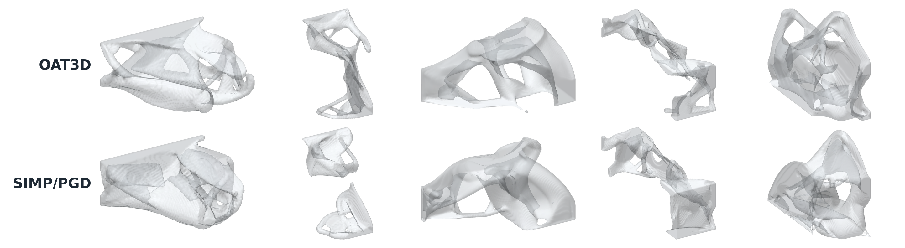
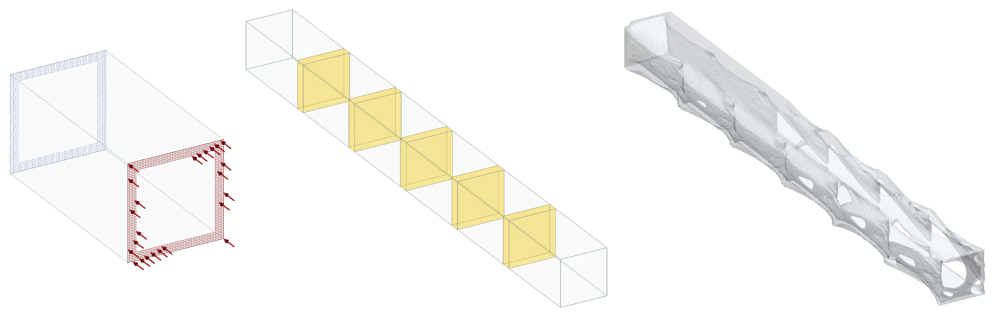

# OAT3D

**A Generative Model for 3D Shape- and Resolution-Free Structural Topology Optimization**

OAT3D generates a 3D material-density field from a design domain, supports, applied forces, and target volume fraction. Each seed produces a candidate on the native voxel grid. The repository includes 50 example boundary conditions.



Five test problems share the same camera and scale within each column. The upper row shows the raw OAT3D decoder output at seed 0. The lower row shows the corresponding ground-truth SIMP/PGD densities. Both surfaces use an isovalue of 0.30.

## Generate a topology

From the repository root, download the weights and run the example below in a configured GPU environment.

```bash
hf download ggrayt/OAT3D_weights --local-dir weights
python generate.py --case examples/00109b45acda42b1.npz --weights weights --out outputs
```

The example produces a 56 × 40 × 40 density field. Read the native XYZ array and threshold it to obtain a solid mask.

```python
import numpy as np

with np.load("outputs/00109b45acda42b1/seed_00.npz") as result:
    density = result["density"].astype(np.float32)
solid = density > 0.3
```

To generate all 32 candidates for the same problem, use a fresh output directory. Seeds run from 0 through 31. Pass several paths to `--case` to reuse the model across problems.

```bash
python generate.py --case examples/00109b45acda42b1.npz --weights weights --out outputs/ensemble --candidates 32
```

## Plot raw topologies

Install the plotting dependencies in the inference environment. The off-screen renderer uses PyVista and VTK, marching cubes on the native XYZ grid, and the paper's lighting and orthographic camera. Headless Linux systems use EGL.

```bash
python -m pip install -r requirements-plot.txt
python generate.py --raw --weights weights --out outputs/raw --case \
  examples/0039a8f1fd0ea232.npz examples/00d837ae85c95e22.npz \
  examples/008fc167a86ba903.npz examples/007a661bae01fa66.npz examples/00ff517ecd50cd5f.npz
python plot_topology.py compare --predictions outputs/raw --out outputs/comparison.png
```

The five case IDs appear in the same left-to-right order as the figure. The comparison command pairs fresh predictions with the included SIMP/PGD reference images. To render directly from reference densities, pass `--references DATASET_ROOT` with archives arranged as `<first-two-hex-digits>/<case-id>_topo.npz`, each containing a native XYZ array named `topo`.

Use `single` to plot any generated density. Add `--boundary examples/<case-id>.npz` to show fixed nodes and force arrows.

```bash
python plot_topology.py single outputs/raw/0039a8f1fd0ea232/seed_00.npz --out outputs/topology.png
```

## Resolution-free tower



The selected design uses **overlap weight 100 and seed 6**. From left to right, the figure shows the supports and axial loads for one segment, the five shared regions in yellow, and the generated 703 × 60 × 60 tower. [Full-resolution paper figure](figures/resolution-free.pdf)

Six 128 × 60 × 60 segments overlap by 13 voxels along X. Their target volume fractions, from base to tip, are 0.30, 0.27, 0.24, 0.21, 0.18, and 0.15. The sampler shares the initial noise across segments and guides neighboring predictions toward agreement in their overlap regions. Each stage uses 20 Euler steps. A linear blend assembles the final density.

```bash
python -m experiments.tower --weights weights --out outputs/tower --weight 100 --seed 6
python plot_topology.py tower outputs/tower/weight_100/seed_06.npz --out outputs/tower.png
```

To reproduce the four-weight sweep, run seeds 0 through 31 at each weight in a fresh output directory.

```bash
for weight in 1 10 100 1000; do
  python -m experiments.tower --weights weights --out outputs/tower-sweep --weight "$weight" --seed 0 --candidates 32
done
```

Each tower archive contains the assembled density, the six segment densities in base-to-tip order, their start indices and target fractions, the overlap width, weight, and seed.

## GPU environment

Use Linux, Python 3.10, and a CUDA GPU with bfloat16 support. The following setup targets CUDA 13.0 with a matching CUDA toolkit and PyTorch build. Install the system build prerequisites for TorchSparse and FlashAttention first. [TorchSparse installation](https://torchsparse.readthedocs.io/en/latest/getting_started/installation.html) · [FlashAttention installation](https://github.com/Dao-AILab/flash-attention#installation-and-features)

```bash
python -m pip install torch==2.12.0 --index-url https://download.pytorch.org/whl/cu130
python -m pip install -r requirements.txt cupy-cuda13x==13.6.0 ninja packaging psutil wheel
python -m pip install --no-build-isolation flash-attn==2.8.3.post1
python -m pip install --no-build-isolation "torchsparse @ git+https://github.com/mit-han-lab/torchsparse.git@385f5ce8718fcae93540511b7f5832f4e71fd835"
```

## Supply your own boundary conditions

Save the following arrays in a NumPy `.npz` file. Use XYZ order throughout. A domain of `(nx, ny, nz)` cells has nodes ranging from `(0, 0, 0)` through `(nx, ny, nz)`, inclusive.

| Array | Shape | Meaning |
| --- | --- | --- |
| `dims` | `(3,)` | Integer cell counts along X, Y, Z, each from 3 through 512 |
| `vf` | scalar | Target solid volume fraction between 0 and 1 |
| `bcs` | `(N, 3)` | Integer support-node coordinates |
| `bc_c` | `(N, 3)` | Constrained displacement components, with 1 for fixed and 0 for free |
| `loads` | `(M, 3)` | Integer load-node coordinates, grouped by load object |
| `load_v` | `(M, 3)` | Applied force vector at each corresponding node |
| `load_indptr` | `(K+1,)` | Integer offsets into the load rows for the K load objects |

For one load object, set `load_indptr = [0, M]`. For two objects containing three and five load rows, use `[0, 3, 8]`. The supports must constrain rigid-body motion. OAT3D removes force components along constrained degrees of freedom and normalizes the remaining forces by the largest absolute component.

## Output

Each `<out>/<case>/seed_<nn>.npz` contains the seed and a float16 `density` array in `[0, 1]` with shape `(nx, ny, nz)`. The dense stage locates material support and the sparse stage resolves the density on the native grid. Both use 10 Euler steps, with guidance scales of 5 and 2.5, respectively.

The sparse operators and VAE components incorporate code from Direct3D-S2. Third-party notices are included in this repository. [Direct3D-S2](https://github.com/DreamTechAI/Direct3D-S2)
